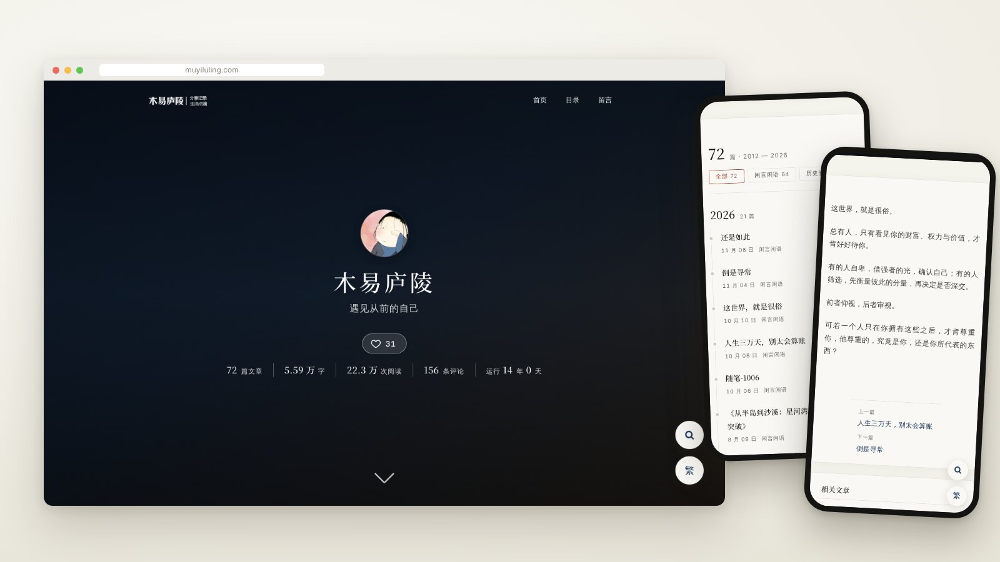

# Bubble Kami

Typecho 清新风格响应式主题：社区维护的 Bubble 优化分支，内置「Kami」纸质书质感外观。化繁为简，如沐清风。

> 原项目已停止维护。本分支适配 **Typecho 1.3 / PHP 8**（理论上兼容 1.1 / 1.2），移除了原版存在安全隐患的自动更新器、失效的在线字体与第三方脚本。目录名为 `Bubble-Kami`，可与原版 `Bubble` 并存。问题与建议欢迎提交 issue 或 PR。



# 特性

+ **纸质书外观**：卡片式布局，暖色纸面、墨蓝点缀、衬线标题，桌面与手机自适应
+ **阅读体验**：文章目录、上一篇 / 下一篇与相关文章；再次打开读到一半的文章会提示「继续阅读」
+ **流畅切页**：全站 pjax 与 ajax 评论，切页时文章标题平滑过渡到文章页
+ **右下角浮动按钮**：返回顶部（带阅读进度）、搜索、简繁切换；登录后另有后台按钮
+ **中文排版**：中英文混排自动留白、全角标点挤压，简繁一键切换
+ **代码与公式**：Prism 代码高亮（约 300 种语言、多种配色）、KaTeX 数学公式
+ **短代码**：高亮提示框、友链卡片
+ **站点功能**：首页点赞与博客统计（文章数、字数、阅读数、评论数、运行时长）、时间轴目录页、友链页、关于页、书架页（自动同步微信读书书单）、首页置顶、内置阅读数（兼容 Views 插件数据）、自定义头图 / 壁纸 / LOGO / 样式、404 页面
+ **SEO 与分享**：JSON-LD 结构化数据，分享卡片自动带文章摘要与首图
+ **轻量快速**：静态资源全部自托管，无 jQuery，代码高亮、公式、图片查看器等按需加载
+ **配置持久化**：切换到其它主题再切回，外观设置自动恢复（Typecho 1.2+）

完整更新记录见 [CHANGELOG.md](./CHANGELOG.md)。

# 使用

## 安装与更新

从 [Releases](https://github.com/liyouzi80/Bubble-Kami/releases) 下载最新 zip，解压得到 `Bubble-Kami` 目录，放到 Typecho 的 `usr/themes/` 下，再到后台启用。

更新时下载新版 zip，删除旧的主题目录后重新放入即可（本分支没有在线更新，原版的在线更新存在安全风险已移除）。设置会保留；新版本增加的设置项可能为空，请到「设置外观」确认一遍。

> 主题会把外观设置额外备份到 `bubblekami:config`，切换主题再切回时自动恢复。从旧版本升级后，先访问一次前台或在「设置外观」里保存一次，以生成备份。

## 设置

后台 → 控制台 → 外观 → 设置外观。图片地址请填完整 URL，不要用相对地址。

### 外观

+ **站点副标题**：首页标题栏中站点标题后显示的文字。
+ **站点图标（favicon）地址**：浏览器标签页上的小图标 URL，留空使用主题自带图标。
+ **导航栏 LOGO 图片**：填入图片 URL 后，左上角用图片代替站点名称；留空显示文字。导航栏是深色背景，建议用浅色、透明底的 PNG / SVG，高度 80px 以上（显示高度桌面 40px、手机 32px）。
+ **标题字体子集文件**：可选。填入用 `tools/build-title-font.py` 为本站生成的字体地址后，标题优先使用这个只含本站标题用字的小字体，见下方「生成标题字体子集」。
+ **站点头像**：首页大标题上方显示的图片 URL。
+ **首页背景图像**：首页背景图片 URL，留空则使用默认紫色渐变背景。
+ **随机背景图像地址**：文章页 / 独立页等页面的头图，每行一个 URL，从中随机抽取；留空则使用默认紫色渐变背景。
+ **页脚左下角文字**：页脚说明文字（如 Copyright、备案信息），可含 HTML。
+ **站点创建时间**：格式如 `2012-11-17 00:00:00`，用于首页统计的运行时长；关闭「首页点赞与统计」时，改在页脚显示「距今已有 X 年 X 天 X 小时 X 分」。
+ **首页点赞与统计**：是否在首页大图的题句下方显示点赞按钮与博客统计。点赞不去重，可以连点；发文、改文或有新评论后统计立即更新，运行时长按「站点创建时间」计算，未填写时从第一篇文章算起。
+ **页脚小工具**：是否在页面底部显示「最新评论 / 最新文章 / 近期归档」。
+ **首页置顶文章 CID**：填写文章 CID，多个 CID 用英文逗号分隔；按填写顺序展示在首页最前面。文章 CID 可在 Typecho 后台文章编辑页的地址中查看。
+ **文章阅读数**：开启后在首页文章卡片和文章页显示阅读数，并在打开文章时自动累加。已有 `views` 字段和数据会保留；如果字段不存在，主题会尝试自动创建。旧 Views 插件仍启用时会复用其计数，避免重复累加。
+ **自定义 css**：自定义 css 代码，生效无需清空缓存。
  > `main.min.css` 只保留主题模板用到的 Bootstrap/Argon 样式（另保留 `alert-*`、`badge-*` 及所有元素样式）。如果在文章里手写了其它 Bootstrap class（如 `btn-warning`、`table-striped`、栅格 `col-sm-4` 等），需要在这里补上对应样式。

### 功能

+ **全站 pjax 模式**：是否启用全站 pjax。开启后可能影响部分第三方插件（详见「pjax 回调代码」）。
+ **pjax 回调代码**：pjax 渲染完毕后执行的 JS，用于修复第三方插件在无刷新场景下的失效问题。切页后，正文区域里的内联脚本已会自动重新执行，一般不需要填写；只有依赖页面加载事件（如 `DOMContentLoaded`）初始化的插件才需要在这里补调用。例如：

```js
myFunction();
```

+ **katex 数学公式渲染**：是否启用 KaTeX。行内公式写作 `$E=mc^2$`，独立成行的公式写作 `$$\sum_{i=1}^n i$$`；正文里没有 `$` 时不会加载 KaTeX。
+ **prism.js 代码高亮**：是否启用 prism.js；可进一步选择是否显示行号、高亮主题配色。
+ **TOC 文章目录**：是否启用文章目录；可设置默认展开状态。

## 目录页

主题自带时间轴目录（可代替 JustArchives 等归档插件）：新建一个独立页面，右侧「自定义模板」选「目录（时间轴归档）」，发布即可。页面按年份列出全部已发布文章，顶部可按分类筛选；新文章发布后自动出现。页面正文如果写了内容，会显示在时间轴上方。

## 友链、关于、书架页

和目录页一样：新建独立页面，在「自定义模板」里选对应模板。

+ **友链**：正文里每行一个友链，格式 `站名 | 地址 | 头像 | 描述`（头像、描述可省略；不填头像或头像加载失败时显示站名首字）。其余文字作为说明显示在上方。页面下方自动列出本站信息供对方复制，并保留评论区用于申请。
+ **关于**：正文即自我介绍（段落首行缩进）；上方自动显示头像、站名、题句与建站年份、运行年数、文章数、字数、评论数。可在页面「自定义字段」添加 `email` 显示邮箱链接。
+ **书架（微信读书书单）**：正文里贴上微信读书书单的分享链接（`https://weread.qq.com/misc/booklist/…`），页面会显示书单的真实封面、作者与评分，点封面跳转到微信读书对应的书。书单需公开；主题每天自动同步一次，读取失败时继续显示上次的书目。链接以外的文字作为说明显示在上方。

## 短代码

*若无法正常使用，请尝试关闭第三方插件（如第三方文章编辑器）。*

### 高亮代码框

标签：`bbcode`（`type` 取值 `success` / `danger` / `warning` / `secondary` / `info` / `default` / `primary`）。

```html
<bbcode type="success">这是绿色高亮代码框</bbcode>
<bbcode type="danger">这是红色高亮代码框</bbcode>
<bbcode type="warning">这是橙色高亮代码框</bbcode>
<bbcode type="secondary">这是灰色高亮代码框</bbcode>
<bbcode type="info">这是蓝绿色高亮代码框</bbcode>
<bbcode type="default">这是深蓝色高亮代码框</bbcode>
<bbcode type="primary">这是紫色高亮代码框</bbcode>
```

### 友链

标签：`bblist`（列表）、`bblink`（项）。

```html
<bblist>
<bblink link="友链 URL" icon="友链图标 URL" des="友链描述">友链名称</bblink>
</bblist>
```

示例：

```html
<bblist>
<bblink link="https://tntofu.com" icon="https://tntofu.com/usr/uploads/2020/03/4228973783.jpg" des="三硝基豆腐的博客">豆腐蒸锅</bblink>
<bblink link="https://blog.boxpaper.club" icon="https://tntofu.com/usr/uploads/2020/04/2709766458.png" des="/ No Result !">Rorical</bblink>
</bblist>
```

# 维护与发布

面向本仓库维护者，使用主题无需关心。

## 自动发布

已配置 GitHub Actions（`.github/workflows/release.yml`），推送到 `main` 后按 `index.php` 中的 `@version` 自动发布主题 zip：

+ **新版本号**：创建新的 Release 并附带 `bubble-kami-版本号.zip`。
+ **版本号不变**：用最新代码重新打包，覆盖该版本的 zip，并把 `v版本号` 标签移到最新提交，标签、Source code 与 zip 保持一致。
+ Release 说明首行注明构建来源的提交号与时间，便于区分同一版本的不同构建。
+ 只改 `README.md` / `CHANGELOG.md` / `LICENSE` / `tools/` / `.github/` 时不触发；需要时可在 Actions 页面的 Release 工作流点 **Run workflow** 手动发布。

同一版本内的改动，更新记录直接写在 `CHANGELOG.md` 当前版本号下面。

## 重新生成 main.min.css

`main.min.css` 由 Argon 全量样式按模板与脚本实际用到的 class 精简而来。模板里新增了 Bootstrap/Argon class 时需要重新生成：

```bash
npm i --no-save purgecss@6
git show 1d223d3:assets/css/main.min.css > /tmp/argon-full.css
node tools/purge-css.js /tmp/argon-full.css
```

只在 JS 里拼接、或由 Typecho/插件输出的 class，需要加进 `tools/purge-css.js` 的 safelist。`tools/` 目录不会打包进发布的 zip。

## 生成标题字体子集

标题使用思源宋体（Noto Serif SC），默认按「用到哪些字就下载哪些字体切片」加载。中文切片每片约 40KB，标题用字分散时一个页面要下载十几片（实测首页约 600KB）。为本站生成一个只含标题用字的子集，通常只有几十 KB，全站共用、可长期缓存：

```bash
pip install fonttools brotli
python3 tools/build-title-font.py https://你的域名/ -o title-font.woff2
```

脚本会抓取站点所有公开文章与页面，收集站名、文章与页面标题、分类与标签名及主题的固定标题文字，从 Google Fonts 的 Noto Serif SC 可变字体（首次运行自动下载约 25MB）截出 500 字重子集，字形与原切片完全一致。把生成的 woff2 上传到网站（如 `usr/uploads/`），在「设置外观 → 标题字体子集文件」填入地址。

+ 子集里没有的字（新文章标题里的新字、文章正文的小标题等）会自动回退到原来的切片，显示不会出错；发了一批新文章后重新生成一次即可。
+ 加 `--with-headings` 会同时收录文章正文里的小标题，子集更大，但打开这些文章时不再需要额外的切片。

## 为旧图片补登记附件

从 WordPress 等迁移过来的图片只存在于 `usr/uploads/`，数据库里没有附件记录，所以后台「管理 → 文件」里看不到（前台显示不受影响）。`tools/register-attachments.php` 会扫描上传目录，为没有记录的文件补登记；能找到引用它的文章时，同时关联到该文章。脚本不会改动文件和文章正文。

1. 先备份数据库，再把脚本上传到 Typecho 根目录（与 `config.inc.php` 同级）。
2. 命令行运行 `php register-attachments.php` 预览，确认后加 `--apply` 写入；加 `--only-referenced` 只登记被文章引用过的文件。
3. 没有命令行时：把脚本里的 `RUN_KEY` 改成一串随机字符，浏览器访问 `/register-attachments.php?key=那串字符` 预览，加 `&apply=1` 写入。
4. 用完立即删除脚本。重复运行是安全的，已登记的文件会跳过。

# License 与致谢

MIT License。

+ 原版主题由 [三硝基豆腐](https://github.com/trinitrotofu)、[Rorical](https://github.com/Liupaperbox) 和 [Totorato](https://github.com/totorato) 共同完成
+ 基于 [Argon Design System](https://www.creative-tim.com/product/argon-design-system)；评论模块部分代码参照 Typecho 官方主题 Default
+ 相关主题：[Rorical](https://github.com/Liupaperbox/Rorical) · [Bubble（Totorato 修改版）](https://github.com/totorato/Bubble)
