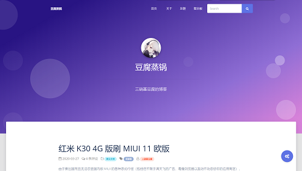

# Bubble Kami

Typecho 清新风格响应式主题（社区维护的 Bubble 优化分支，内置「Kami」纸质书质感外观）。

化繁为简，如沐清风。

> 本仓库为社区维护分支（原项目已停止维护），已适配 **Typecho 1.3.0 / PHP 8.x**，并移除了原版中存在安全隐患的自动更新器、失效的在线字体与第三方脚本。使用中如发现问题，欢迎提交 issue 或 PR。
>
> **与原版 Bubble 共存**：本主题目录名为 `Bubble-Kami`，与原版 `Bubble` 不同名，可直接并存、互不覆盖。

# 特性

+ 清新界面：基于 argon design system 的卡片式布局，内置「Kami」暖色墨蓝、衬线标题的纸质书质感外观
+ 人性化设计：登录后显示后台管理按钮，布局自适应
+ 流畅体验：支持全站 pjax、ajax 评论无刷新
+ 文章导航：上一篇 / 下一篇 + 相关文章推荐
+ SEO 优化：内置 JSON-LD 结构化数据（Article + BreadcrumbList）
+ 性能优化：静态资源自托管，`main.min.css` 按模板实际用到的 class 精简（约 42KB），FontAwesome 子集化为 21 个图标，移除 jQuery 依赖，脚本移至页面底部、正文图片懒加载与 WebP 响应式图片
+ 简繁转换：自托管脚本，一键切换简体 / 繁体，适配 pjax
+ 代码高亮：自带 prism.js，主题丰富，解析迅速
+ 数学公式：自带 KaTeX 渲染，相比 MathJax 更轻量
+ 短代码：高亮代码框、友链卡片
+ 自定义壁纸：首页固定壁纸、其他页面随机壁纸
+ 自定义样式：支持用户添加 css，随意调整外观
+ 首页置顶：可按 CID 顺序将文章置于首页列表前面
+ 阅读数：主题内置浏览统计，可沿用 Views 插件已有数据
+ 配置持久化：切换主题后再切回，外观设置自动保留（需 Typecho 1.2+）
+ 兼容性：适配 Typecho 1.3.0 / PHP 8.x

# 使用

## 安装

从 [Releases](https://github.com/liyouzi80/Bubble-Kami/releases) 下载最新 zip，解压后得到 `Bubble-Kami` 目录，移动到 Typecho 主题目录 `usr/themes/` 下，再到后台启用。

> 建议使用 Typecho 1.3.0 及以上版本（PHP 8.0+）。本主题已通过 1.3.0 的兼容性适配，理论上也兼容 1.1/1.2。

## 更新

本分支已移除原版的「一键自动更新」功能（该功能会向主题目录写入无需登录即可访问的更新脚本，存在安全风险），请手动更新：从 Releases 下载新版 zip，删除旧主题目录后重新安装。

> 注意：更新后可能新增设置项，旧配置会保留；新增的选项（主要是选择型设置项）可能留空，请到「设置外观」确认一遍。

> **配置持久化**：本主题会把外观设置额外镜像到独立的 `bubblekami:config`（不会被切换主题时删除），切换主题后再切回来，设置会自动恢复（需 Typecho 1.2+）。从旧版本升级后，请先访问一次前台页面（或在「设置外观」里保存一次），以生成配置备份；之后再切换主题即可无损。

> **自动发布**：本仓库已配置 GitHub Actions，向 `main` 分支提交新的主题版本号（`index.php` 中的 `@version`）后，会自动创建对应版本的 Release 并附带主题 zip。

## 设置

主题设置页面：Typecho 后台 → 控制台 → 外观 → 设置外观。

### 外观

+ **站点副标题**：首页标题栏中站点标题后显示的文字。
+ **站点 LOGO**：浏览器标签标题左侧显示的图片 URL（请勿使用相对地址）。
+ **站点头像**：首页大标题上方显示的图片 URL（请勿使用相对地址）。
+ **首页背景图像**：首页背景图片 URL，留空则使用默认紫色渐变背景（请勿使用相对地址）。
+ **随机背景图像地址**：文章页 / 独立页等页面的头图，每行一个 URL，从中随机抽取；留空则使用默认紫色渐变背景（请勿使用相对地址）。
+ **页脚左下角文字**：页脚说明文字（如 Copyright、备案信息），可含 HTML。
+ **站点创建时间**：格式如 `2012-11-17 00:00:00`，用于页脚显示「本站已运行 X 年 X 天」，留空则不显示。
+ **页脚小工具**：是否在页面底部显示「最新评论 / 最新文章 / 近期归档」。
+ **首页置顶文章 CID**：填写文章 CID，多个 CID 用英文逗号分隔；按填写顺序展示在首页最前面。文章 CID 可在 Typecho 后台文章编辑页的地址中查看。
+ **文章阅读数**：开启后在首页文章卡片和文章页显示阅读数，并在打开文章时自动累加。已有 `views` 字段和数据会保留；如果字段不存在，主题会尝试自动创建。旧 Views 插件仍启用时会复用其计数，避免重复累加。
+ **自定义 css**：自定义 css 代码，生效无需清空缓存。
  > `main.min.css` 只保留主题模板用到的 Bootstrap/Argon 样式（另保留 `alert-*`、`badge-*` 及所有元素样式）。如果在文章里手写了其它 Bootstrap class（如 `btn-warning`、`table-striped`、栅格 `col-sm-4` 等），需要在这里补上对应样式。

### 功能

+ **全站 pjax 模式**：是否启用全站 pjax。开启后可能影响部分第三方插件（详见「pjax 回调代码」）。
+ **pjax 回调代码**：pjax 渲染完毕后执行的 JS，用于修复第三方插件在无刷新场景下的失效问题。例如：

```js
myFunction();
```

+ **katex 数学公式渲染**：是否启用 KaTeX。
+ **prism.js 代码高亮**：是否启用 prism.js；可进一步选择是否显示行号、高亮主题配色。
+ **TOC 文章目录**：是否启用文章目录；可设置默认展开状态。

## 短代码

*若无法正常使用，请尝试关闭第三方插件（如第三方文章编辑器）。*

### 高亮代码框

标签：`bbcode`（`type` 取值 `success` / `danger` / `warning` / `secondary` / `info` / `default` / `primary`）。

```html
<bbcode type="success">这是绿色高亮代码框</bbcode>
<bbcode type="danger">这是红色高亮代码框</bbcode>
<bbcode type="warning">这是橙色高亮代码框</bbcode>
<bbcode type="secondary">这是灰色高亮代码框</bbcode>
<bbcode type="info">这是蓝绿色高亮代码框</bbcode>
<bbcode type="default">这是深蓝色高亮代码框</bbcode>
<bbcode type="primary">这是紫色高亮代码框</bbcode>
```

### 友链

标签：`bblist`（列表）、`bblink`（项）。

```html
<bblist>
<bblink link="友链 URL" icon="友链图标 URL" des="友链描述">友链名称</bblink>
</bblist>
```

示例：

```html
<bblist>
<bblink link="https://tntofu.com" icon="https://tntofu.com/usr/uploads/2020/03/4228973783.jpg" des="三硝基豆腐的博客">豆腐蒸锅</bblink>
<bblink link="https://blog.boxpaper.club" icon="https://tntofu.com/usr/uploads/2020/04/2709766458.png" des="/ No Result !">Rorical</bblink>
</bblist>
```

# 截图



# License

Open sourced under the MIT license.

# 其他

+ 原版主题由 [三硝基豆腐](https://github.com/trinitrotofu)、[Rorical](https://github.com/Liupaperbox) 和 [Totorato](https://github.com/totorato) 三人共同完成
+ 基于 [Argon Design System](https://www.creative-tim.com/product/argon-design-system)
+ 评论模块部分代码参照 Typecho 官方主题 Default
+ 相关主题：[Rorical](https://github.com/Liupaperbox/Rorical) · [Bubble（Totorato 修改版）](https://github.com/totorato/Bubble)

# 更新历史

## 未发布

+ 修复页脚运行配置脚本的语法错误（`siteUrl()` 直接输出导致），pjax、图片查看器、Prism、KaTeX 按需加载恢复工作
+ pjax 切页后重新执行页内脚本，修复切页后 TOC 目录与 ajax 评论失效；附件链接与同页锚点不再被 pjax 拦截
+ 自托管 Prism 语言包（`assets/js/prism-components/`），修复除核心语言外无法高亮
+ 开启 pjax 时不再输出 Speculation Rules 悬停预取（pjax 用不上，徒增请求）；预取请求不计入阅读数
+ `main.min.css` 按模板实际用到的 class 精简（186KB → 42KB，gzip 后 30KB → 9KB），可用 `tools/purge-css.js` 重新生成
+ 其它：随机头图兼容 `\r\n` 与空行、`og:url` 正确输出、导航与评论区 HTML 结构修正

## 4.2.4

+ 主页/归档：无标签或无分类的文章不再显示孤立的标签/文件夹图标
+ 文章页顺序调整为 上一篇/下一篇 → 相关文章 → 评论区
+ 前端样式打磨：导航栏滚动状态兜底（IntersectionObserver 强制深色，修复无 hero 页面与 pjax 状态错位）、上一篇/下一篇两列对齐、卡片元信息降噪（去除作者与「无标签」徽章、「继续阅读」改纯文字箭头）
+ 性能：KaTeX / Prism / Viewer 改为按正文内容懒加载，散文页不再白下约 300KB 脚本；首页/归档卡片正文图片改为服务端懒加载
+ 首页 hero 顶部遮罩加重，`theme-color` 对齐品牌墨蓝 `#1B365D`
+ 标题衬线字体自托管 Noto Serif SC（500，unicode-range 切片，共 101 个 woff2），跨平台标题呈现统一

## 4.2.3

+ 新增配置持久化：切换主题后再切回，外观设置自动保留（需 Typecho 1.2+）。
+ PrismJS 高亮样式改为自托管，移除 jsDelivr CDN 依赖
+ 内联脚本抽取为 `assets/js/theme.js`（导航折叠 / 回到顶部 / pjax / 评论 / 弹窗），页面只保留一小段运行配置
+ `themeAsset` 增加文件修改时间缓存，`printAricle` 更名 `printArticle`，内联 `clear_urlcan`

## 4.2.2

+ 新增主题内置首页置顶文章功能，可按 CID 顺序配置；置顶查询仅在首页运行。
+ 新增主题内置文章阅读数，沿用已有 views 数据并兼容 Views 插件。

## 4.2.1

+ 新增 Speculation Rules API 悬停预取，配合 pjax 让站内导航近乎零延迟
+ 首屏正文图片 `fetchpriority="high"`，优化 LCP 关键渲染路径
+ 提示弹窗改用原生 `<dialog>`，替代 Bootstrap modal
+ pjax 切换加入 View Transitions 视图过渡（自动降级、尊重 `prefers-reduced-motion`）
+ CSS 现代化增量：标题 `text-wrap: balance`、正文 `text-wrap: pretty`、`:has()` 评论层级、容器查询
+ 设计打磨：暖棕阴影、平滑锚点滚动、按压反馈、`<dialog>` 弹入动画、纸面噪点质感、跳过导航链接、全面减动效兜底

## 4.2.0

+ 移除「背景气泡」设置项及其渲染逻辑
+ 新增 GitHub Actions 自动发布：提交新的 `@version` 后自动创建 Release 并附带 zip
+ 新增上一篇 / 下一篇导航与相关文章
+ 新增 JSON-LD 结构化数据（Article + BreadcrumbList）
+ 移除 jQuery 依赖，pjax / 评论 / 图片查看器 / 进度条改为原生 JS
+ 正文图片懒加载与 WebP 响应式图片
+ 更新 README 文档

## 4.1.0

+ 适配 Typecho 1.3.0 / PHP 8.x
+ 移除存在安全隐患的「一键自动更新」功能
+ 移除失效的 Google Fonts 镜像，改用系统中文字体栈，避免渲染阻塞
+ 简繁转换改为自托管脚本，默认简体，并适配 pjax
+ 修复文章列表对第三方 Views 浏览统计插件的硬依赖
+ 新增「站点创建时间」设置项
+ 新增 `lang`、Open Graph、`theme-color` 等元信息
+ 将 jQuery、viewer.js 等脚本移至页面底部，消除首屏渲染阻塞
+ `main.min.css` CSS 树摇（234KB → 186KB），移除未使用的组件
+ FontAwesome 子集化，仅保留 21 个图标（31KB+175KB → 约 8KB）
+ 移除 Bootstrap JS 与 Popper.js，导航栏折叠改用原生 JS（约 90KB）
+ 正文图片懒加载
+ 内置「Kami」纸质书质感外观作为默认样式
+ 主题更名为 Bubble Kami，可与原版并存

## 4.0.x

+ 4.0.1：修复副标题显示不正确的问题
+ 4.0.0：卡片式布局、TOC 目录、viewer.js 图片查看器、回到顶部、副标题设置（原版「自动更新」已在本分支移除）

## 3.x

+ 3.0.3：优化 pjax 进度条、图片圆角、搜索框美化等
+ 3.0.2：首页壁纸全屏、翻页自动滚动
+ 3.0.1：修复评论卡托条、左上角标题颜色问题
+ 3.0.0：新增 pjax、ajax 评论、KaTeX、prism.js、短代码；采用 jsDelivr CDN

## 2.x 及更早

原版的早期更新历史，详见原仓库提交记录。
